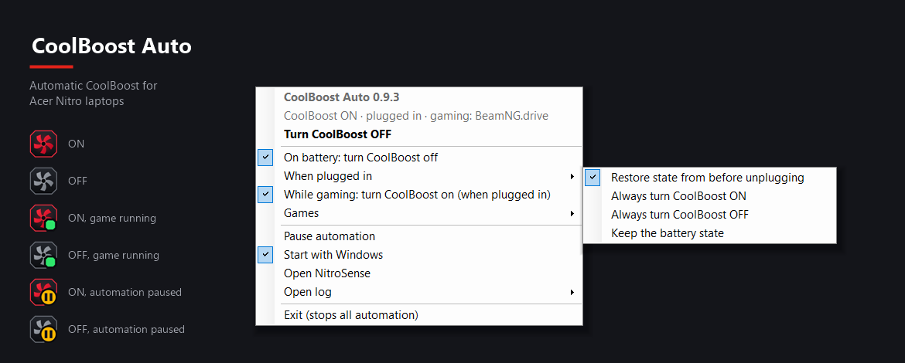

# CoolBoost Auto

**Automatic CoolBoost™ for Acer Nitro laptops.** CoolBoost Auto switches CoolBoost on and off for you, based on what you're doing: off on battery, back on when you plug in, on while you're gaming. When you want manual control, one click on the tray icon toggles it. NitroSense itself never has to open.

🇧🇷 [Leia em português](README.pt-BR.md)

> Not affiliated with or endorsed by Acer. *Acer, Nitro, NitroSense and CoolBoost are trademarks of Acer Inc.*

## Features

### Automatic switching by context

- **On battery:** CoolBoost turns **off** when you unplug, so the fans don't drain the battery.
- **When you plug in:** you choose what happens:
  - **Restore previous state** (default)
  - **Always ON**
  - **Always OFF**
  - **Leave it as it is**
- **While gaming:** CoolBoost turns **on** while a game is running and goes back to its previous state when the game closes.
  - Games are detected from Windows' own game list, your Steam libraries and Rockstar games, plus any app you mark yourself. New installs are picked up automatically.
  - Uninstallers, crash reporters and launchers are ignored.
  - If you change CoolBoost yourself mid-game, the automation leaves it alone until the game closes.
  - On battery, the battery rule wins.
- It also re-checks after boot and after waking from sleep, in case you plugged or unplugged in between.

### Manual control when you want it

- **One-click on/off:** left-click the tray icon to toggle CoolBoost instantly. No admin prompt.
- **Tray icon (NitroSense style):** red fan = ON, grey fan = OFF, green badge = game running. Right-click for all the options.
- **No NitroSense window.** CoolBoost is switched through the same firmware call NitroSense uses, and NitroSense's own setting is kept in sync, so the app always shows the right state.

## Compatibility

| | |
|---|---|
| **Tested on** | Acer Nitro 5 **AN515-55**, Windows 11, NitroSense 3.01 |
| **Likely works on** | Other Acer Nitro models with NitroSense whose firmware exposes the `APGeAction` WMI interface |
| **Not supported yet** | Predator laptops with PredatorSense (help testing is welcome) |
| **Requires** | NitroSense installed, Windows PowerShell 5.1 (built into Windows 10/11), an admin account for installing |

The installer checks compatibility first, not the model name: if the CoolBoost interface or NitroSense is missing, it stops without changing anything. If you try it on another model, please open an issue saying whether it worked.

## Install

1. Download **`CoolBoostAuto-Setup-x.y.z.exe`** from the [latest release](https://github.com/edgarmcarvalho/nitrosense-coolboost-auto/releases/latest).
2. Run it, accept the admin (UAC) prompt and click through the wizard.
   - The wizard checks your laptop first. If it isn't supported, it stops before installing anything.
   - Windows SmartScreen may warn because the installer isn't code-signed: **More info → Run anyway**.
3. A red fan icon appears next to the clock. It may be hidden under the **^** arrow; drag it onto the taskbar to keep it visible.

Running a newer setup upgrades an existing install and keeps your settings.

Prefer scripts? Install without the wizard

Download `CoolBoostAuto-Scripts-x.y.z.zip` from the release (or **Code → Download ZIP**), extract it, then right-click **`install.ps1`** → **Run with PowerShell**. Options: `-NoAutostart` (don't start the icon at login). To remove: **`uninstall.ps1`**, with `-KeepSettings` to keep your settings.

## Uninstall

**Settings → Apps → Installed apps → CoolBoost Auto → Uninstall.** CoolBoost stays in whatever state it was in.

## Using it

Right-click the tray icon:

- **Turn CoolBoost ON / OFF**
- **Automation**
  - **Turn off on battery**
  - **When plugged in:** Restore previous state / Always turn ON / Always turn OFF / Leave it as it is
  - **Turn ON while gaming**
  - **Mark a running app as a game**: for anything that isn't detected automatically
  - **Stop treating as a game**: if something triggers by mistake (*Reset exclusions* undoes it)
- **Open NitroSense** / **Open log**

You can also reopen it from the Start menu: **CoolBoost Auto**.

## How it works

| Part | Where | Runs as |
|---|---|---|
| Worker (`CoolBoostSys.ps1`) | `C:\Program Files\CoolBoostAuto` (admin-only) | SYSTEM, via scheduled tasks |
| Tray icon (`CoolBoostTray.ps1`) | `C:\ProgramData\CoolBoostAuto` | you |
| Settings (`settings.json`), tray log | `C:\ProgramData\CoolBoostAuto` | — |
| Worker log | `C:\Program Files\CoolBoostAuto\CoolBoostAuto.log` | — |

**Scheduled tasks**
- `CoolBoostAuto` runs on power plug/unplug (Kernel-Power event 105), at startup and after waking from sleep.
- `CoolBoostToggle`, `CoolBoostOn` and `CoolBoostOff` can be started by normal users. That's how the tray icon switches CoolBoost without admin rights.

**The CoolBoost call:** CoolBoost is read with `APGeAction.GetFunction(0x207)` (the state is in byte 1) and set with `APGeAction.SetFunction((state << 16) | 7)`, in the `root\WMI` namespace.

**Security notes**
- The SYSTEM part lives in an admin-only folder.
- It reads only true/false values and a fixed list of options from the user-editable settings file.
- No network access and no telemetry.

## Building the installer

Releases are built by GitHub Actions ([`.github/workflows/release.yml`](.github/workflows/release.yml)) whenever a `v*` tag is pushed. It compiles [`installer/setup.iss`](installer/setup.iss) with Inno Setup and attaches the setup, a scripts zip and checksums to the release. To build locally: `ISCC.exe /DAppVersion=0.9.0 installer\setup.iss`.

## Known limitations

- Tested only on the AN515-55. Other models may use different firmware calls.
- If you exit the tray icon while a game is running, CoolBoost stays in its current state.
- A game is identified by its executable. Games that run through a launcher stub get detected once the real game process starts.

## Code signing policy

The setup is currently **unsigned**: Windows SmartScreen may warn about it, and **Smart App Control blocks it**. If you have Smart App Control on, use the scripts zip instead. Signing through the [SignPath Foundation](https://signpath.org) open-source program has been requested. Once it is approved, every release built by the [release workflow](.github/workflows/release.yml) will be signed, and this section will say so.

- Committers and reviewers: [@edgarmcarvalho](https://github.com/edgarmcarvalho)
- Approvers: [@edgarmcarvalho](https://github.com/edgarmcarvalho)

**Privacy:** this program does not transfer any information to other networked systems. It works entirely offline.

## Credits

- The CoolBoost firmware command was identified thanks to **[OpenPredator](https://github.com/KRWCLASSIC/OpenPredator)** by KRWCLASSIC (MIT), an open-source reimplementation of the NitroSense/PredatorSense stack. No code was copied; the call was verified independently on an AN515-55.
- Built by [@edgarmcarvalho](https://github.com/edgarmcarvalho) with help from Claude (Anthropic).

## License

[MIT](LICENSE). Provided as-is, without warranty. You use it at your own risk.
