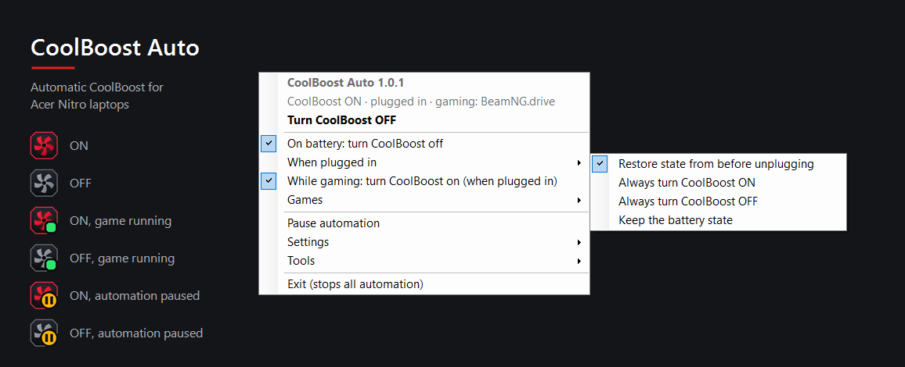

# CoolBoost Auto

**CoolBoost™ automático para notebooks Acer Nitro.** Ele **desliga o CoolBoost na bateria**, **volta para a sua escolha quando você conecta o carregador** e **liga enquanto você joga**. Um clique no ícone da bandeja alterna quando você quiser. O NitroSense nunca precisa abrir.

**[⬇ Baixar a versão mais recente](https://github.com/edgarmcarvalho/nitrosense-coolboost-auto/releases/latest)** · 🇺🇸 [Read in English](README.md)

> Projeto sem vínculo com a Acer e não endossado por ela. *Acer, Nitro, NitroSense e CoolBoost são marcas registradas da Acer Inc.*

## O que ele faz

| Quando… | O CoolBoost Auto… |
|---|---|
| **Você tira o carregador** | **Desliga** o CoolBoost, para as ventoinhas não gastarem a bateria. |
| **Você conecta de novo** | Aplica a sua regra: **restaurar** o estado de antes de desconectar (padrão), **sempre ligar**, **sempre desligar** ou **manter** o estado da bateria. |
| **Um jogo abre** (na tomada) | **Liga** o CoolBoost e volta ao que era quando o jogo fecha. |
| **Você muda o CoolBoost durante um jogo** | Respeita a sua escolha até o jogo fechar. |
| **O notebook liga ou volta da suspensão** | Confere de novo, caso a fonte de energia tenha mudado. |

Na bateria, a regra da bateria sempre vence: um jogo nunca liga o CoolBoost com o carregador desconectado.

## Instalação

1. Baixe o **`CoolBoostAuto-Setup-x.y.z.exe`** da [versão mais recente](https://github.com/edgarmcarvalho/nitrosense-coolboost-auto/releases/latest).
2. Execute e aceite o pedido de administrador. Ele verifica o notebook primeiro e não instala nada se o modelo não for compatível.
3. Uma ventoinha vermelha ou cinza aparece ao lado do relógio (ou na setinha **^**; arraste-a para a barra de tarefas para deixá-la sempre visível).

**Atualizar:** rode o instalador da versão nova por cima da antiga. Suas configurações são mantidas.

**Desinstalar:** *Configurações → Aplicativos → Aplicativos instalados → CoolBoost Auto → Desinstalar*. Tudo é removido; o CoolBoost fica no estado em que estiver.

> **Avisos do Windows:** o instalador ainda não tem assinatura digital. O SmartScreen pode mostrar *O Windows protegeu o computador* (clique em **Mais informações → Executar assim mesmo**). Se o **Controle Inteligente de Aplicativos** (Smart App Control) bloquear, use os scripts abaixo.

<b>Instalar com scripts em vez do assistente</b>

Baixe o `CoolBoostAuto-Scripts-x.y.z.zip` da versão, extraia e clique com o botão direito em **`install.ps1`** → **Executar com o PowerShell**.

- `-NoAutostart`: não iniciar com o Windows (dá para ligar depois pelo menu).
- Para remover: rode o **`uninstall.ps1`** (com `-KeepSettings`, suas configurações ficam guardadas).

## Como usar

| Ícone | Significado |
|:---:|---|
|  | CoolBoost **ligado** |
|  | CoolBoost **desligado** |
|   | **Jogo aberto** |
|   | Automação **pausada** |

- **Clique esquerdo** liga ou desliga o CoolBoost, sem pedido de administrador.
- **Passe o mouse** para ver o que está acontecendo, por exemplo *CoolBoost ON · plugged in · gaming: BeamNG.drive*.
- **Clique direito** abre o menu.

Sempre que o CoolBoost troca, um pequeno aviso aparece acima da barra de tarefas por uns 3 segundos e diz o motivo, em inglês (*unplugged*, *gaming: (o jogo)*, *game closed*…). Ele nunca rouba o foco; para desligar, use **On-screen notice** no menu.

<b>Tudo o que tem no menu</b> (o menu é em inglês)

- **Turn CoolBoost ON / OFF**: liga / desliga, igual ao clique esquerdo.
- **On battery: turn CoolBoost off**: a regra da bateria (necessária para o *Restore*).
- **When plugged in** (ao conectar) ▸ *Restore state from before unplugging* (restaurar o estado de antes) · *Always ON* (sempre ligar) · *Always OFF* (sempre desligar) · *Keep the battery state* (manter o estado da bateria).
- **While gaming: turn CoolBoost on (when plugged in)**: a regra dos jogos.
- **Games** ▸ os jogos detectados agora, **Add a running app** (tratar um app aberto como jogo), **Ignore a game** (ignorar algo detectado por engano) e **Ignored apps** (clique em um para voltar a considerá-lo).
- **Pause automation**: nada muda sozinho até você desmarcar. O clique no ícone continua funcionando.
- **Start with Windows** (iniciar com o Windows) · **On-screen notice** (aviso na tela).
- **Check for updates automatically** (desligado por padrão) · **Check for updates now**: pergunta ao GitHub o número da versão mais recente e avisa se houver uma nova. Nunca baixa nem instala nada.
- **Open NitroSense** · **Open log**.
- **Exit (stops all automation)**: fecha o ícone e para todas as regras até você abrir o CoolBoost Auto de novo pelo menu Iniciar.

## Como os jogos são detectados

A cada poucos segundos, o CoolBoost Auto considera um programa aberto como jogo se:

- **o Windows já sabe que é um jogo** (a lista que a Barra de Jogo usa), ou
- ele foi instalado pela **Steam**, **Epic Games**, **GOG**, **Ubisoft Connect**, **EA app**, **Battle.net**, **app Xbox / Game Pass**, **Amazon Games**, **Riot Games**, **itch.io** ou **Rockstar Games**, ou
- você o adicionou em **Games ▸ Add a running app**.

Não há lista para manter. Launchers, instaladores, atualizadores, relatórios de erro e serviços anti-cheat são ignorados. Jogos comprados em outras lojas (Nuuvem, Humble…) são reconhecidos pela loja onde foram ativados; um jogo sem DRM numa pasta própria pode ser adicionado à mão.

## Compatibilidade

| | |
|---|---|
| **Funciona em** | Acer Nitro 5 **AN515-55** (testado, Windows 11, NitroSense 3.01) · Acer Nitro 5 **AN515-57** (segundo um usuário) |
| **Provavelmente funciona em** | Outros Acer Nitro com NitroSense |
| **Ainda não suportado** | Notebooks Predator com PredatorSense (quem puder testar é bem-vindo) |
| **Não suportado** | Predator Triton 300 **PT315-53** (a Acer não oferece CoolBoost nele) |
| **Requer** | NitroSense instalado (não precisa estar aberto), Windows 10 ou 11 de 64 bits, conta de administrador para instalar |

O instalador verifica a interface do CoolBoost e o NitroSense, não o nome do modelo, e não altera nada se faltar algum dos dois.

**Testou em outro modelo?** [Envie um relato de compatibilidade](https://github.com/edgarmcarvalho/nitrosense-coolboost-auto/issues/new?template=compatibility-report.yml), mesmo que não tenha funcionado. O formulário inclui uma [verificação de hardware](tools/hardware-check.ps1) opcional, somente de leitura, que nunca altera nenhuma configuração.

## Solução de problemas

**O CoolBoost mudou quando eu não esperava.** Passe o mouse no ícone para ver o status e depois veja o **Open log**: toda troca fica registrada com o motivo. Se parecer um bug, [abra uma issue](https://github.com/edgarmcarvalho/nitrosense-coolboost-auto/issues) com o modelo do notebook e os dois logs.

**Um jogo não liga o CoolBoost.** Confira se o carregador está conectado e se o ícone não está com o selo de pausa. Depois use **Games ▸ Add a running app** com o jogo aberto.

**Algo que não é jogo liga o CoolBoost.** Use **Games ▸ Ignore a game**.

**O ícone sumiu.** Provavelmente você clicou em **Exit**. Abra o **CoolBoost Auto** de novo pelo menu Iniciar.

**Ele deixa o notebook mais lento?** Não. Parado, ele usa cerca de 0,1% da CPU e uns 130 MB de memória.

## Privacidade

Sem telemetria, sem conta, nada sai do seu notebook. A única exceção é a verificação opcional de atualizações, que pergunta ao GitHub o número da versão mais recente quando você a liga ou clica nela.

## Política de assinatura de código

O instalador ainda **não é assinado**. A assinatura pelo programa open source da [SignPath Foundation](https://signpath.org) foi solicitada; quando for aprovada, todas as versões geradas pelo [workflow de release](.github/workflows/release.yml) serão assinadas, e esta seção será atualizada.

- Commits e revisão: [@edgarmcarvalho](https://github.com/edgarmcarvalho)
- Aprovação: [@edgarmcarvalho](https://github.com/edgarmcarvalho)

**Privacidade:** este programa não envia nenhuma informação para outros sistemas em rede, a menos que o usuário ou quem o instala ou opera peça isso. A única coisa que pode usar a rede é a verificação opcional de atualizações (**Check for updates now** ou **Check for updates automatically**, desligada por padrão): ela pergunta ao GitHub o número da versão mais recente e não envia mais nada.

## Como funciona

<b>Detalhes técnicos</b>

| Parte | Onde | Roda como | Faz |
|---|---|---|---|
| Serviço (`CoolBoostSys.ps1`) | `C:\Program Files\CoolBoostAuto` (só administradores alteram) | SYSTEM, via tarefas agendadas | Troca o CoolBoost, aplica as regras de conectar/desconectar |
| Ícone (`CoolBoostTray.ps1`) | `C:\ProgramData\CoolBoostAuto` | você | Ícone, menu, detecção de jogos |

- **Tarefas agendadas:** `CoolBoostAuto` roda quando a fonte de energia muda (evento 105 do Kernel-Power), na inicialização e ao voltar da suspensão. `CoolBoostOn`, `CoolBoostOff` e `CoolBoostToggle` podem ser iniciadas por usuários comuns; é assim que o ícone troca o CoolBoost sem pedido de administrador.
- **A chamada do CoolBoost:** lida com `APGeAction.GetFunction(0x207)` (byte 1) e definida com `APGeAction.SetFunction((estado << 16) | 7)` em `root\WMI`, a mesma chamada de firmware que o NitroSense usa. A configuração do próprio NitroSense (`HKLM\SOFTWARE\OEM\NitroSense\FanControl\CoolBoostMode`) é mantida em sincronia.
- **Arquivos:** configurações em `C:\ProgramData\CoolBoostAuto\settings.json`; logs em `C:\Program Files\CoolBoostAuto\CoolBoostAuto.log` (energia e manual) e `C:\ProgramData\CoolBoostAuto\tray.log` (jogos), ambos reduzidos automaticamente.
- **Segurança:** a parte SYSTEM fica numa pasta que só administradores podem alterar e, do arquivo de configurações (editável pelo usuário), só lê valores verdadeiro/falso e uma lista fixa de opções.
- **Geração do instalador:** o GitHub Actions ([`release.yml`](.github/workflows/release.yml)) gera cada tag `v*`: confere a sintaxe do PowerShell, compila o [`installer/setup.iss`](installer/setup.iss) com o Inno Setup e anexa o instalador, um zip com os scripts e os checksums SHA-256, com as notas de [`release-notes/`](release-notes). Localmente: `ISCC.exe /DAppVersion=1.2.3 installer\setup.iss`.
- **Limitações:** os jogos são identificados pelo executável, então um jogo aberto por um launcher conta quando o jogo em si começa a rodar. Feito em Windows PowerShell, usa mais memória que um app nativo (cerca de 130 MB).

## Créditos

- O comando de firmware do CoolBoost foi identificado graças ao **[OpenPredator](https://github.com/KRWCLASSIC/OpenPredator)**, de KRWCLASSIC (MIT). Nenhum código foi copiado; a chamada foi verificada de forma independente num AN515-55.
- Obrigado a todos que testaram no próprio notebook e deram retorno.
- Criado por [@edgarmcarvalho](https://github.com/edgarmcarvalho) com ajuda do Claude (Anthropic).

## Licença

[MIT](LICENSE). Fornecido "como está", sem garantia. Use por sua conta e risco.
