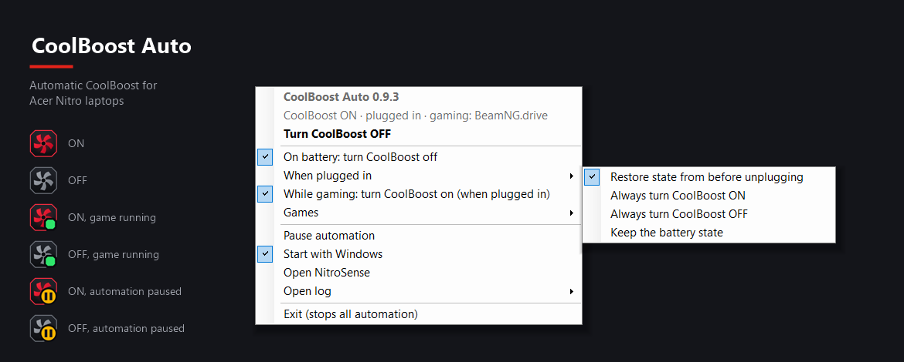

# CoolBoost Auto

**CoolBoost™ automático para notebooks Acer Nitro.** O CoolBoost Auto liga e desliga o CoolBoost para você, de acordo com o que você está fazendo: **desliga na bateria**, **volta para a sua escolha quando você conecta o carregador** e **liga enquanto você joga**. Quando quiser decidir você mesmo, um clique no ícone da bandeja alterna. O NitroSense nunca precisa abrir.

**[⬇ Baixar a versão mais recente](https://github.com/edgarmcarvalho/nitrosense-coolboost-auto/releases/latest)** · 🇺🇸 [Read in English](README.md)

> Projeto sem vínculo com a Acer e não endossado por ela. *Acer, Nitro, NitroSense e CoolBoost são marcas registradas da Acer Inc.*

## O que ele faz

| Quando… | O CoolBoost Auto… |
|---|---|
| **Você tira o carregador** | **Desliga** o CoolBoost, para as ventoinhas não gastarem a bateria, e lembra se ele estava ligado. |
| **Você conecta de novo** | Aplica a sua regra: **restaurar** o estado de antes de desconectar (padrão), **sempre ligar**, **sempre desligar** ou **manter** o estado da bateria. |
| **Um jogo abre** (na tomada) | **Liga** o CoolBoost e o deixa como estava quando o jogo fecha. |
| **Você muda o CoolBoost durante um jogo** | Respeita a sua escolha até o jogo fechar, seja pelo ícone da bandeja ou pelo NitroSense. |
| **O notebook liga ou volta da suspensão** | Confere de novo, caso você tenha conectado ou desconectado o carregador nesse meio-tempo. |
| **Você pausa a automação** | Não muda nada até você retomar. Aí ele se ajusta ao que tiver mudado. |

Na bateria, a regra da bateria sempre vence: um jogo nunca liga o CoolBoost com o carregador desconectado. Se você conectar o carregador durante um jogo, o CoolBoost volta a ligar alguns segundos depois.

## O ícone da bandeja

| Ícone | Significado |
|:---:|---|
|  | CoolBoost **ligado** |
|  | CoolBoost **desligado** |
|   | **Jogo aberto** e a automação no controle |
|   | **Automação pausada**: nada muda sozinho |

- **Clique esquerdo** liga ou desliga o CoolBoost, sem pedido de administrador. O ícone muda assim que o notebook confirma a troca, então ele sempre mostra o estado real.
- **Passe o mouse** para ver o que está acontecendo, por exemplo *CoolBoost ON · plugged in · gaming: BeamNG.drive*.
- **Clique direito** abre o menu.

## O menu

O menu é em inglês. O que cada item faz:

- **CoolBoost Auto x.y.z** e uma **linha de status**: o que o CoolBoost está fazendo e por quê.
- **Turn CoolBoost ON / OFF**: liga / desliga, igual ao clique esquerdo.
- **On battery: turn CoolBoost off**: a regra da bateria. O *Restore* (abaixo) depende dela, porque é nesse momento que o estado é guardado.
- **When plugged in** (ao conectar o carregador) ▸ *Restore state from before unplugging* (restaurar o estado de antes) · *Always turn CoolBoost ON* (sempre ligar) · *Always turn CoolBoost OFF* (sempre desligar) · *Keep the battery state* (manter o estado da bateria)
- **While gaming: turn CoolBoost on (when plugged in)**: a regra dos jogos (só na tomada).
- **Games** ▸ os jogos detectados agora, mais:
  - **Add a running app**: tratar um app aberto como jogo, para o que não for detectado sozinho.
  - **Ignore a game**: ignorar algo que liga o CoolBoost por engano.
  - **Ignored apps**: apps ignorados; clique em um para voltar a considerá-lo.
- **Pause automation**: pausa toda a troca automática até você desmarcar. O clique no ícone continua funcionando.
- **Start with Windows**: iniciar o CoolBoost Auto ao entrar no Windows.
- **Open NitroSense** · **Open log** (troca por energia e manual, ou automação de jogos).
- **Exit (stops all automation)**: fecha o ícone e desliga todas as regras até você abrir o CoolBoost Auto de novo pelo menu Iniciar. O CoolBoost fica como está.

## Como os jogos são detectados

O CoolBoost Auto olha os programas abertos a cada poucos segundos e considera um deles jogo se:

- **o Windows já sabe que é um jogo** (a mesma lista que a Barra de Jogo usa), ou
- ele está instalado numa das suas **bibliotecas da Steam** ou na pasta **Rockstar Games**, ou
- você o adicionou em **Games ▸ Add a running app**.

Jogos novos são reconhecidos sozinhos, sem lista para manter. Launchers, desinstaladores, relatórios de erro, atualizadores e serviços anti-cheat são ignorados. O jogo é identificado pelo executável, então jogos abertos por um launcher são detectados quando o jogo em si começa a rodar. Se algo for detectado por engano, use **Games ▸ Ignore a game**.

## Compatibilidade

| | |
|---|---|
| **Testado em** | Acer Nitro 5 **AN515-55** (Windows 11, NitroSense 3.01) · Acer Nitro 5 **AN515-57** (funcionando segundo um usuário) |
| **Provavelmente funciona em** | Outros Acer Nitro com NitroSense cujo firmware tenha a interface WMI `APGeAction` |
| **Ainda não suportado** | Notebooks Predator com PredatorSense (ajuda para testar é bem-vinda) |
| **Requer** | NitroSense instalado (não precisa estar aberto), Windows 10 ou 11 (64 bits), conta de administrador para instalar |

O instalador verifica a interface do CoolBoost e o NitroSense, não o nome do modelo. Se faltar algum dos dois, ele para sem alterar nada. Testou em outro modelo? [Abra uma issue](https://github.com/edgarmcarvalho/nitrosense-coolboost-auto/issues) contando se funcionou, para ele entrar nesta lista.

## Instalação

1. Baixe o **`CoolBoostAuto-Setup-x.y.z.exe`** da [versão mais recente](https://github.com/edgarmcarvalho/nitrosense-coolboost-auto/releases/latest).
2. Execute, aceite o pedido de administrador (UAC) e avance pelo assistente. Ele verifica o notebook primeiro e para antes de instalar qualquer coisa se o modelo não for compatível.
3. Uma ventoinha vermelha ou cinza aparece ao lado do relógio. Se não aparecer, ela está na setinha **^**; arraste-a para a barra de tarefas para deixá-la sempre visível.

**Atualizar:** rode o instalador da versão nova por cima da antiga. Suas configurações são mantidas.

**Avisos do Windows:** o instalador ainda não tem assinatura digital (veja a [Política de assinatura de código](#política-de-assinatura-de-código)). O SmartScreen pode mostrar *O Windows protegeu o computador*: clique em **Mais informações → Executar assim mesmo**. Se o **Controle Inteligente de Aplicativos** (Smart App Control) bloquear, use o zip com os scripts abaixo.

<b>Instalar com scripts em vez do assistente</b>

Baixe o `CoolBoostAuto-Scripts-x.y.z.zip` da versão (ou **Code → Download ZIP**), extraia e clique com o botão direito em **`install.ps1`** → **Executar com o PowerShell**.

- `-NoAutostart`: desmarca **Start with Windows** (dá para religar pelo menu).
- Para remover: rode o **`uninstall.ps1`**. Com `-KeepSettings`, suas configurações ficam guardadas para uma reinstalação.

## Desinstalação

**Configurações → Aplicativos → Aplicativos instalados → CoolBoost Auto → Desinstalar.** Tudo é removido: o ícone da bandeja, as tarefas agendadas, os arquivos e os atalhos. O CoolBoost fica no estado em que estiver; mude no NitroSense se precisar.

## Solução de problemas

**O CoolBoost mudou quando eu não esperava.** Passe o mouse no ícone ou abra o menu para ver a linha de status. Depois veja o **Open log**: toda troca, automática ou manual, fica registrada lá com o motivo. Se parecer um bug, [abra uma issue](https://github.com/edgarmcarvalho/nitrosense-coolboost-auto/issues) com o modelo do notebook e os dois logs.

**Um jogo não liga o CoolBoost.** Confira se o carregador está conectado e se o ícone não está com o selo de pausa. Depois use **Games ▸ Add a running app** com o jogo aberto.

**Algo que não é jogo liga o CoolBoost.** Use **Games ▸ Ignore a game**.

**O ícone sumiu.** Provavelmente você clicou em **Exit**. Abra de novo pelo menu Iniciar: **CoolBoost Auto**.

**Ele deixa o notebook mais lento?** Não. Parado, ele usa cerca de 0,1% da CPU e uns 130 MB de memória (ele roda no Windows PowerShell).

## Como funciona

O CoolBoost Auto tem duas partes:

| Parte | Onde | Roda como | O que faz |
|---|---|---|---|
| Serviço (`CoolBoostSys.ps1`) | `C:\Program Files\CoolBoostAuto` (só administradores alteram) | SYSTEM, via tarefas agendadas | Troca o CoolBoost e aplica as regras de conectar/desconectar |
| Ícone (`CoolBoostTray.ps1`) | `C:\ProgramData\CoolBoostAuto` | você | O ícone e o menu, a detecção de jogos |

**Tarefas agendadas**
- `CoolBoostAuto` roda quando a fonte de energia muda (evento 105 do Kernel-Power), na inicialização e ao voltar da suspensão. O ícone também a inicia quando abre e quando a automação é retomada. Ela não faz nada com a automação pausada ou com o CoolBoost Auto fechado.
- `CoolBoostOn`, `CoolBoostOff` e `CoolBoostToggle` podem ser iniciadas por usuários comuns. É assim que o ícone troca o CoolBoost sem pedido de administrador.

**A chamada do CoolBoost:** o estado é lido com `APGeAction.GetFunction(0x207)` (fica no byte 1) e definido com `APGeAction.SetFunction((estado << 16) | 7)`, no namespace `root\WMI`. É a mesma chamada de firmware que o NitroSense usa. A configuração do próprio NitroSense (`HKLM\SOFTWARE\OEM\NitroSense\FanControl\CoolBoostMode`) é mantida em sincronia, então o app do NitroSense sempre mostra o estado certo.

**Arquivos**
- Configurações: `C:\ProgramData\CoolBoostAuto\settings.json`
- Logs: `C:\Program Files\CoolBoostAuto\CoolBoostAuto.log` (troca por energia e manual) e `C:\ProgramData\CoolBoostAuto\tray.log` (automação de jogos). Os dois são reduzidos automaticamente.

**Segurança e privacidade**
- A parte que roda como SYSTEM fica numa pasta que só administradores podem alterar.
- Do arquivo de configurações, que você pode editar, ela só lê valores verdadeiro/falso e uma lista fixa de opções.
- Sem acesso à internet e sem telemetria. Tudo fica no seu notebook.

## Como o instalador é gerado

As versões são geradas pelo GitHub Actions ([`.github/workflows/release.yml`](.github/workflows/release.yml)) sempre que uma tag `v*` é enviada. O workflow confere a sintaxe do PowerShell, compila o [`installer/setup.iss`](installer/setup.iss) com o Inno Setup e anexa à versão o instalador, um zip com os scripts e os checksums SHA-256, com as notas de [`release-notes/`](release-notes). Para gerar localmente: `ISCC.exe /DAppVersion=1.2.3 installer\setup.iss`.

## Política de assinatura de código

O instalador ainda **não é assinado**. O SmartScreen do Windows pode avisar e o Controle Inteligente de Aplicativos pode bloqueá-lo; se isso acontecer, use o zip com os scripts. A assinatura pelo programa open source da [SignPath Foundation](https://signpath.org) foi solicitada. Quando for aprovada, todas as versões geradas pelo [workflow de release](.github/workflows/release.yml) serão assinadas, e esta seção será atualizada.

- Commits e revisão: [@edgarmcarvalho](https://github.com/edgarmcarvalho)
- Aprovação: [@edgarmcarvalho](https://github.com/edgarmcarvalho)

**Privacidade:** este programa não envia nenhuma informação para outros sistemas em rede. Ele funciona totalmente offline.

## Limitações conhecidas

- Testado apenas no AN515-55 e no AN515-57. Outros modelos podem usar chamadas de firmware diferentes; o instalador se recusa a instalar se a chamada não existir.
- Os jogos são identificados pelo executável (veja [Como os jogos são detectados](#como-os-jogos-são-detectados)).
- Feito em Windows PowerShell, então usa mais memória do que um app nativo usaria (cerca de 130 MB).

## Créditos

- O comando de firmware do CoolBoost foi identificado graças ao **[OpenPredator](https://github.com/KRWCLASSIC/OpenPredator)**, de KRWCLASSIC (MIT), uma reimplementação open source do NitroSense/PredatorSense. Nenhum código foi copiado; a chamada foi verificada de forma independente num AN515-55.
- Obrigado a todos que testaram no próprio notebook e deram retorno.
- Criado por [@edgarmcarvalho](https://github.com/edgarmcarvalho) com ajuda do Claude (Anthropic).

## Licença

[MIT](LICENSE). Fornecido "como está", sem garantia. Use por sua conta e risco.
